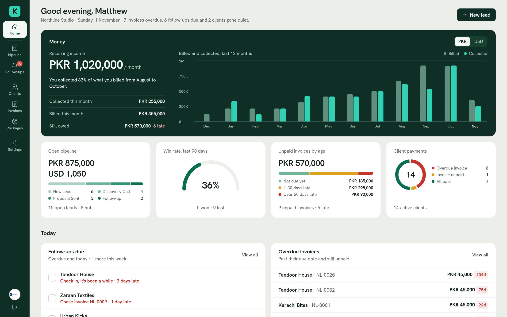
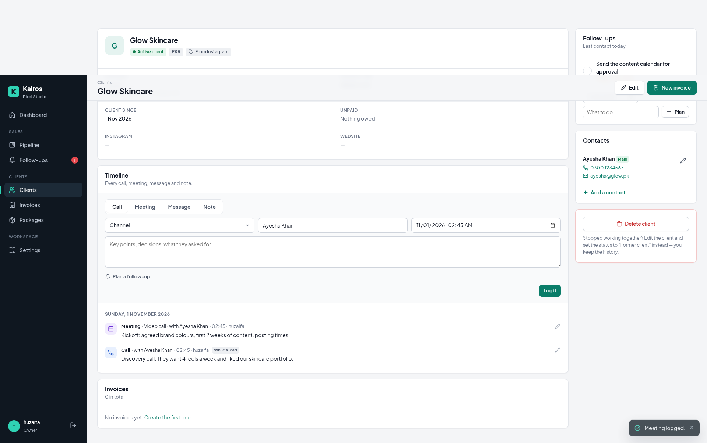
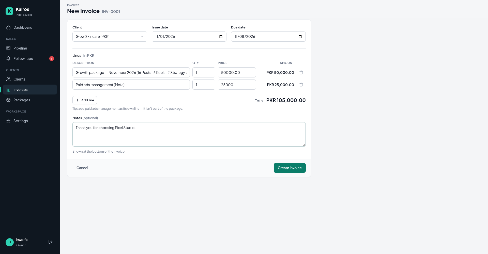
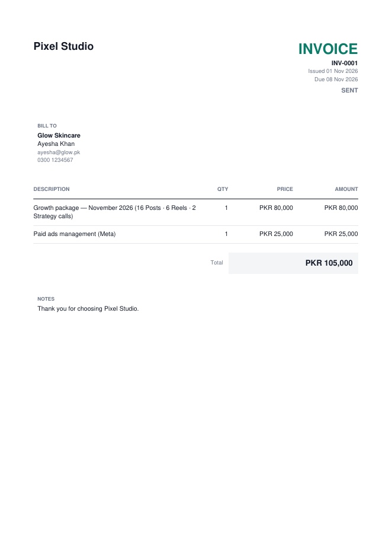
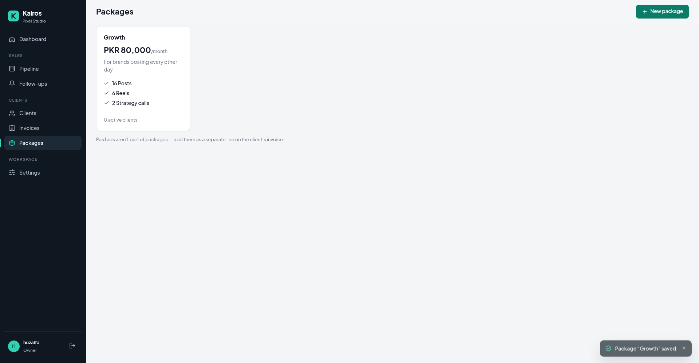
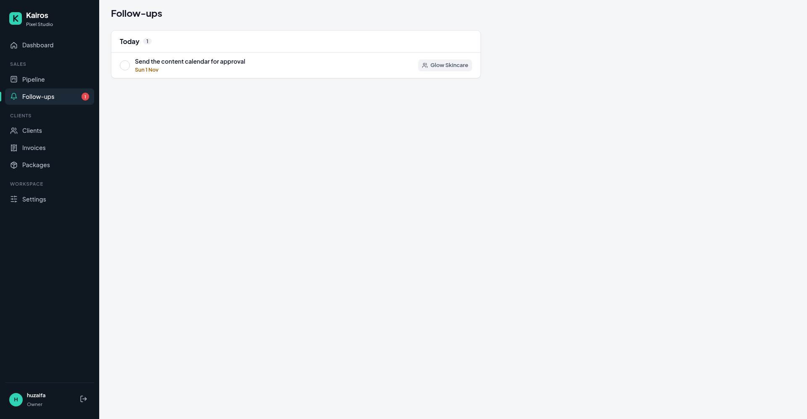
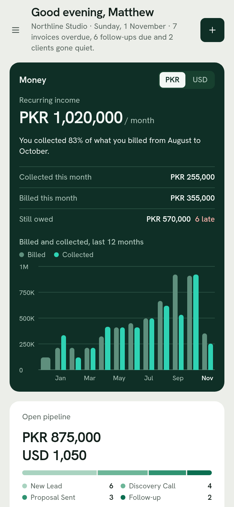

# Kairos

A mini CRM for marketing agencies. Track leads from first message to signed client, keep every conversation in one place, send invoices, and see how the business is doing at a glance.

Most CRMs are built for generic sales teams and need weeks of setup. Kairos follows the way a small agency actually works: leads come in from Instagram, referrals, ads and outreach, plenty of them are junk, and the good ones move through a discovery call, a proposal and a follow-up before they're won or lost.

It runs on your own computer, so your client data stays with you. There's no cloud account and no monthly fee.

> **This is the demo version of Kairos, with limited features.**
> To get the full version, email [muhmmad.huzaifa0987@gmail.com](mailto:muhmmad.huzaifa0987@gmail.com).



## What's in the demo

### Dashboard
Your morning view of the business.

- Recurring income, plus billed vs collected for the last 12 months
- Open pipeline value, win rate and unpaid invoices grouped by how late they are
- Follow-ups due today, which you can tick off right there
- A lead funnel that shows where you lose the most leads
- New leads per week, leads by source and the reasons deals were lost
- Where your recurring income comes from, and how much rests on your three biggest clients
- A 12-week calendar of client contact, and a list of clients who have gone quiet

If you work in more than one currency, money is shown one currency at a time. PKR and USD are never added together.

### Pipeline
- A drag-and-drop board: New Lead, Discovery Call, Proposal Sent, Follow-up, Won, Lost
- A list view with search, filters and bulk actions
- Hot or cold tags, lead sources and days in stage on every card
- One-click junk, so low-value leads get out of your way but can still be restored
- A required reason whenever a lead is marked as lost
- Full stage history for each lead
- One click to turn a won lead into a client, with their contact and timeline carried over

### Clients and packages
- Client profiles with package, monthly fee, currency, contacts and notes
- Packages that describe what you sell each month, such as 16 posts and 6 reels
- Days since last contact and next follow-up, right in the client list
- Former clients stay on record, so their history isn't lost

### Timeline and follow-ups
- One timeline per lead or client for calls, meetings, messages and notes
- The channel, who you spoke with, when, and what was discussed
- Plan the next follow-up while you log a call
- A follow-ups page sorted into overdue, today and the next 7 days

### Invoices
- Automatic numbering with your own prefix, and totals that update as you type
- Sent and paid status, with overdue invoices flagged for you
- Each invoice in the client's own currency, from 37 available
- PDF export with your logo and payment details
- Urdu, Arabic, Turkish, Polish and other scripts print correctly

Demo PDFs carry a small "Made with Kairos" line at the bottom of the page.

### Settings
- Agency profile and logo
- Your own lists of lead sources and lost reasons
- Invoice numbering, payment details and account details

## Demo vs full version

| | Demo | Full version |
|---|---|---|
| Dashboard, charts and pipeline | ✓ | ✓ |
| Clients, packages and timeline | ✓ | ✓ |
| Follow-ups | ✓ | ✓ |
| Invoices and PDF export with your logo | ✓ | ✓ |
| No "Made with Kairos" line, plus your brand colour on PDFs | | ✓ |
| Client health score (green, yellow, red) | | ✓ |
| Monthly deliverables, promised vs delivered | | ✓ |
| Meetings with call links and outcomes | | ✓ |
| Onboarding and offboarding checklists | | ✓ |
| Contracts and renewal alerts | | ✓ |
| Custom packages, add-ons and billing plans | | ✓ |
| Tax (GST), partial payments and payment reminders | | ✓ |
| Monthly client report PDF | | ✓ |
| Global search (Ctrl+K) | | ✓ |
| Lead import from other CRMs, Excel and CSV export | | ✓ |
| Daily automatic backups | | ✓ |
| Desktop app with its own icon and window | | ✓ |

**Want the full version?** Email [muhmmad.huzaifa0987@gmail.com](mailto:muhmmad.huzaifa0987@gmail.com).

## Screenshots


| | |
|---|---|
|  |  |
| Client page with timeline and follow-ups | Invoice with live totals |
|  |  |
| The PDF you send to a client | Packages |
|  |  |
| Marking a lead as lost | Follow-ups |
|  |  |
| List view | First-time setup |

It works on phones too:

 

## Install

You need **Python 3.11 or newer**. On Windows, tick "Add Python to PATH" while installing it. Most Linux systems already have Python.

Download this repository, then start Kairos:

| System | How to start |
|---|---|
| Windows | Double-click `run.bat` |
| macOS or Linux | Run `./run.sh` in a terminal |

The first start takes about a minute while Kairos sets itself up. After that it opens in your browser at `http://127.0.0.1:8000`, where you create your workspace and sign-in.

Keep the terminal window open while you use Kairos, and press **Ctrl+C** in it to stop.

To use a different port, run `python3 start.py --port 9000`.

### Forgot your password?

Open a terminal in the Kairos folder and run:

```bash
# macOS or Linux
.venv/bin/python manage.py changepassword <your-username>

# Windows
.venv\Scripts\python manage.py changepassword <your-username>
```

## Your data

Everything is stored in the `data` folder on your computer: the database, your uploaded logo and the installation's secret key. To back up, stop Kairos and copy that folder somewhere safe. To restore, put it back.

To keep your data somewhere else, set the `KAIROS_DATA_DIR` environment variable.

## For developers

Built with Django 5.2, SQLite, plain HTML, CSS and JavaScript, SortableJS for drag and drop, ReportLab for PDFs and Waitress as the server. Charts are plain HTML and SVG, with no chart library. All assets are bundled, so Kairos works offline.

```bash
python3 -m venv .venv
.venv/bin/pip install -r requirements-dev.txt
.venv/bin/python manage.py migrate
KAIROS_DEBUG=1 .venv/bin/python manage.py runserver
.venv/bin/pytest
```

The 158 automated tests run on Windows, macOS and Linux with Python 3.11 and 3.13.

```
apps/core/        Agency settings, setup, sign-in, currencies
apps/pipeline/    Leads, stages, lost reasons, lead sources
apps/clients/     Clients, contacts, packages
apps/activity/    Timeline and follow-ups
apps/invoices/    Invoices, numbering, PDF export
apps/dashboard/   Dashboard and chart data (insights.py)
templates/        Page layout and shared charts
static/           Styles, scripts and fonts
tests/            Automated tests
start.py          Cross-platform launcher
```

## License

The demo is free under the [PolyForm Internal Use License 1.0.0](LICENSE.md):

- **You can** download it, change it and use it to run your own agency.
- **You can't** sell it, redistribute it or offer it to others as a product or service.

Third-party parts keep their own licenses:

- [SortableJS](https://github.com/SortableJS/Sortable): MIT
- [ReportLab](https://www.reportlab.com/opensource/): BSD
- [arabic-reshaper](https://github.com/mpcabd/python-arabic-reshaper): MIT
- [Hanken Grotesk](https://fonts.google.com/specimen/Hanken+Grotesk): SIL Open Font License 1.1, see `static/fonts/OFL.txt`
- [Noto Sans and Noto Naskh Arabic](https://notofonts.github.io/): SIL Open Font License 1.1, see `apps/invoices/fonts/OFL.txt`

## Contact

Questions, or want the full version? Email [muhmmad.huzaifa0987@gmail.com](mailto:muhmmad.huzaifa0987@gmail.com).

Made by [Muhammad Huzaifa](https://github.com/huzexe).
