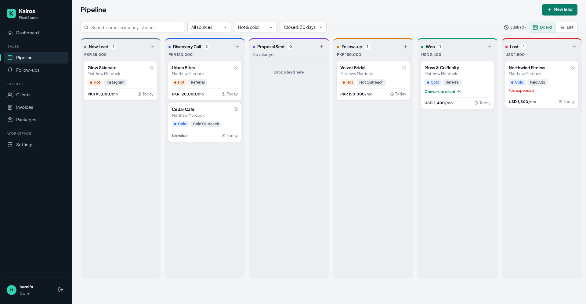
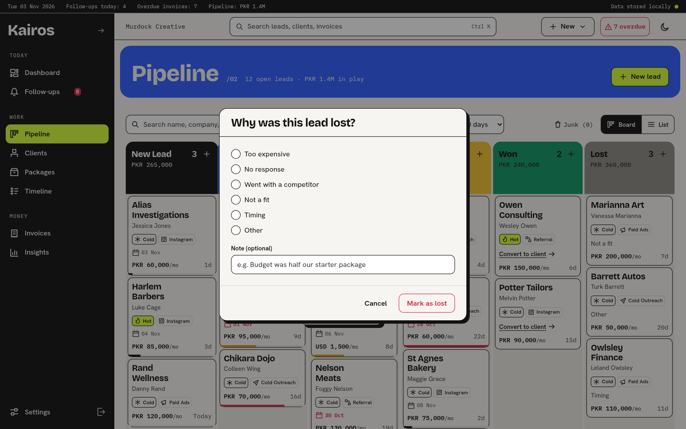
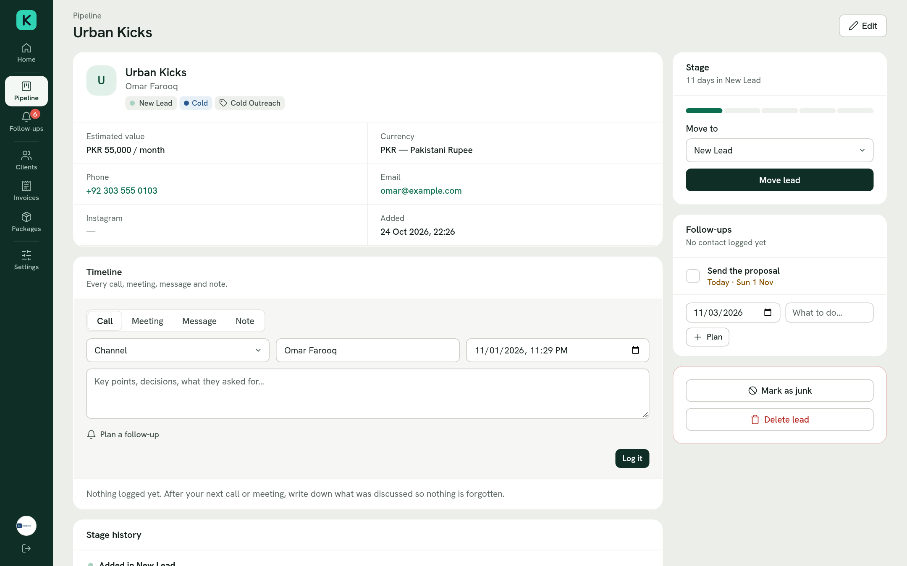
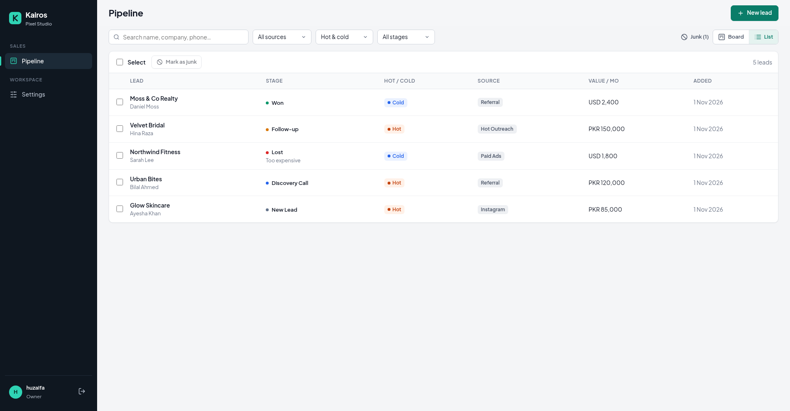
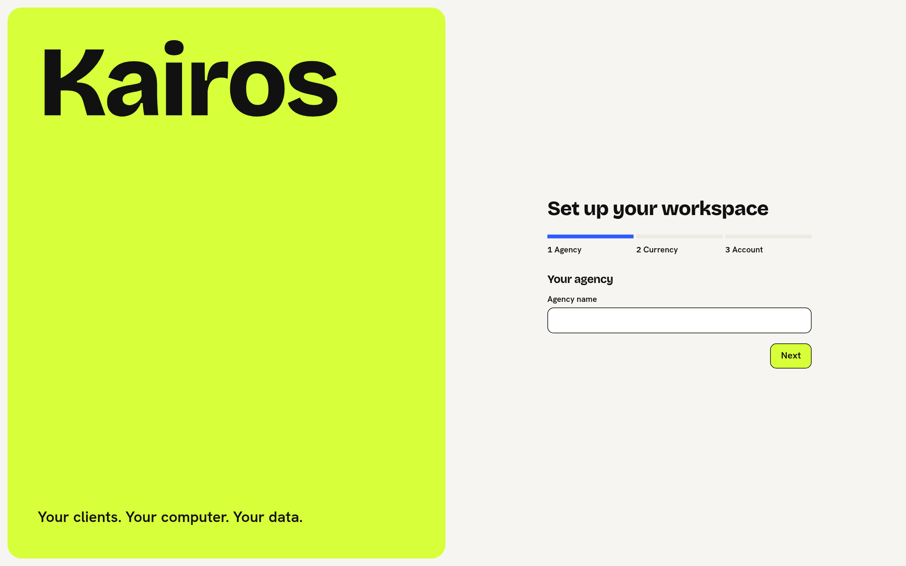
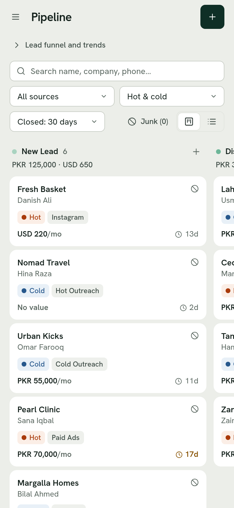

# Kairos: CRM for marketing agencies (Demo edition)

Kairos is a CRM built for marketing agencies, not adapted from a generic sales tool. It follows the way agencies actually sell: leads arrive from Instagram, referrals, ads and outreach. Most of them are junk. The good ones go through a discovery call, a proposal and a follow-up before they're won or lost.

This is the **free demo edition**. It runs on your own computer and keeps all of your data there.



## Features

### Pipeline
- **Kanban board** with the agency sales stages: New Lead → Discovery Call → Proposal Sent → Follow-up → Won / Lost. Drag cards between stages; on phones and tablets, hold a card briefly to drag it.
- **Hot / Cold** tag and **lead source** tag on every lead.
- **One-click junk:** move low-value leads out of the way from the card, or select many at once in the list view. Junk leads can be restored at any time.
- **Lost-reason tracking:** moving a lead to Lost always asks why (Too expensive, No response, and so on), with an optional note.
- **Monthly value per column**, shown separately for each currency (e.g. `PKR 450,000 · USD 2,000`).
- **Days in stage** on every card. Leads that have sat in an open stage for 14 days or more are highlighted.
- **Full stage history** for each lead: who moved it, when, and why it was lost.
- **Board and list views** with search, filtering by source, hot/cold and stage, and pages of 50 leads.
- Won and Lost columns show the **last 30 days** by default, so the board stays tidy after months of use. You can switch to 90 days or all time.

### Workspace
- **First-run setup** creates the owner account and the agency profile. Your time zone is detected automatically.
- **Currency per lead**, chosen from 37 currencies. The agency's default currency is pre-selected.
- **Editable lists** of lead sources and lost reasons: add, rename, reorder or hide items. Items already used on leads can't be deleted, so old records stay correct.
- **Account settings:** change your name, username and password.

### Built properly
- Passwords are stored **hashed** (PBKDF2), never in plain text. Every form is protected against cross-site request forgery.
- Every page requires sign-in.
- Inputs are validated on the server: no negative values, valid Instagram usernames, no duplicate list items, and a lost reason whenever a lead is lost.
- Works on desktop, tablet and phone.
- 62 automated tests, run on Windows, macOS and Linux.

## Screenshots

| | |
|---|---|
|  |  |
| Moving a lead to Lost asks for the reason | Lead page with stage progress and history |
|  |  |
| List view with bulk junk | First-run setup |



## Getting started

You need **Python 3.11 or newer**:
- **Windows / macOS:** download it from [python.org](https://www.python.org/downloads/). On Windows, tick **"Add Python to PATH"** during installation.
- **Linux:** Python is usually installed already.

Then download Kairos and start it:

| System | How to start |
|---|---|
| **Windows** | Double-click `run.bat` |
| **macOS / Linux** | Run `./run.sh` in a terminal, or `python3 start.py` |

The first start takes a minute: it creates a private Python environment in `.venv` and installs what Kairos needs. After that, Kairos starts in a few seconds and opens in your browser at `http://127.0.0.1:8000`. Keep the window open while you use Kairos, and press **Ctrl+C** in it to stop.

The first time, Kairos asks you to create your workspace: agency name, main currency, time zone, and your sign-in.

Options: `python start.py --port 9000` uses another port, and `python start.py --no-browser` doesn't open the browser.

### Forgot your password?

Open a terminal in the Kairos folder and run:

```bash
# macOS / Linux
.venv/bin/python manage.py changepassword <your-username>
# Windows
.venv\Scripts\python manage.py changepassword <your-username>
```

## Your data

Everything Kairos stores is in the **`data`** folder: the database (`kairos.sqlite3`), the installation's secret key, and uploaded files. To back up Kairos, stop it and copy that folder somewhere safe. To restore, put it back.

To keep your data somewhere else, set the `KAIROS_DATA_DIR` environment variable to another folder.

## For developers

```bash
python3 -m venv .venv
.venv/bin/pip install -r requirements-dev.txt     # Windows: .venv\Scripts\pip ...
.venv/bin/python manage.py migrate
KAIROS_DEBUG=1 .venv/bin/python manage.py runserver  # debug pages on
.venv/bin/pytest                                   # run the tests
```

**Stack:** Django 5.2 (LTS), SQLite in WAL mode, plain HTML/CSS and vanilla JavaScript, [SortableJS](https://github.com/SortableJS/Sortable) for drag and drop, and Waitress to serve the app. Everything the pages load is bundled in the project, so Kairos works offline.

### Project structure

```
kairos/                 Django project settings and URLs
apps/core/            Agency settings, first-run setup, sign-in, currencies, shared template tags
apps/pipeline/        Leads, stages, lost reasons, lead sources, board/list views
  services.py         Pipeline rules (moving leads, ordering, junk) — views call these
templates/            Page layout, sign-in pages, shared form pieces, error pages
static/css/kairos.css   All styles (design tokens at the top)
static/js/            kairos.js (shared helpers), board.js (drag and drop)
static/vendor/        SortableJS
static/fonts/         Plus Jakarta Sans (SIL Open Font License)
tests/                Automated tests (pytest)
start.py              Cross-platform launcher
```

## License

Kairos Demo is licensed under the [PolyForm Internal Use License 1.0.0](LICENSE.md). In short:

- **Allowed:** download it and use it, free of charge, to run your own agency's business. You may also change it for that purpose.
- **Not allowed:** selling it, redistributing it, or offering it to others as a product or service.

Bundled third-party parts keep their own licenses:

- [SortableJS](https://github.com/SortableJS/Sortable): MIT License
- [Plus Jakarta Sans](https://fonts.google.com/specimen/Plus+Jakarta+Sans): SIL Open Font License 1.1 (see `static/fonts/OFL.txt`)
